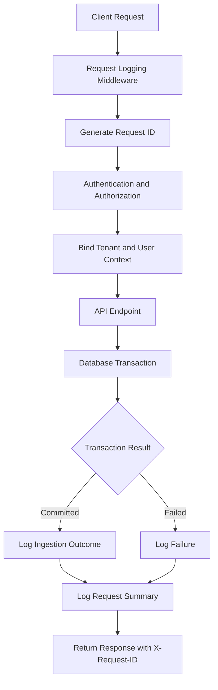

# ADR-003: Structured Application Logging

- **Status:** Accepted (V1 — Implemented)
- **Date:** 2026-11-06
- **Decision:** Use structlog with pure ASGI middleware for structured application logging.

## 1. Current Implementation

The API uses **structlog** to generate consistent, searchable logs for HTTP requests and interaction ingestion.

**Configuration:**

- Logging library: `structlog`
- Middleware: Pure ASGI
- Local environment: Readable console logs
- Production: JSON logs to stdout
- Request tracking: `X-Request-ID` header
- Request context: `contextvars`
- Database: SQLAlchemy with `hide_parameters=True`
- Uvicorn access logs: Disabled

### Architecture



The logging middleware wraps the request-size limiter so even rejected requests receive a request ID.

## 2. Context

The API needs to track requests and understand whether interaction ingestion succeeded, was retried, conflicted, or failed.

Logs must help diagnose issues without exposing sensitive information such as passwords, tokens, prompts, or model responses.

## 3. Decision

Use **structlog** instead of manually formatting log messages.

### Why structlog?

- Structured key-value logging
- Request context propagation in async code
- JSON output for production
- Readable logs during development
- Integration with Python's standard logging

Logs are written to stdout. Storage and collection can be introduced later.

## 4. Logging Events

Each log includes a UTC timestamp, log level, and event name.

| Event | Purpose |
|-------|---------|
| `http_request_completed` | Records method, route, status, and duration |
| `interaction_ingested` | Records successful creation or duplicate retry |
| `interaction_conflict` | Records idempotency conflicts |
| HTTP 429 request summary | Records rate-limit rejection |
| `request_failed` | Records unexpected failures |

### Example Log

```json
{
  "event": "interaction_ingested",
  "outcome": "created",
  "request_id": "req_123",
  "tenant_id": "tenant_456",
  "event_id": "event_789",
  "level": "info"
}
```

**Important:** Successful ingestion is logged only after the database transaction commits.

## 5. Request Context and Error Handling

1. Generate a unique request ID for each request.
2. Return it through the `X-Request-ID` response header.
3. Attach authenticated tenant and user IDs when available.
4. Measure request duration using a monotonic clock.
5. Clear request context after processing.
6. Log unexpected exceptions once, without exposing sensitive data.

### Log Levels

| Level | Usage |
|-------|-------|
| INFO | Successful requests and normal outcomes |
| WARNING | Actionable abnormal conditions |
| ERROR | Unexpected application or database failures |

Expected errors such as validation failures and rate limits generally do not require stack traces.

Unexpected failures before response headers are sent return a generic HTTP 500 with the request ID.

## 6. Security Considerations

Logs must never contain:

- Passwords or authentication tokens
- API keys or authorization headers
- AI prompts or model responses
- Raw request bodies
- Raw idempotency keys
- Sensitive SQL parameters

SQLAlchemy uses `hide_parameters=True` to prevent bound parameters from appearing in database logs and exception strings.

Exception logs exclude messages, source lines, and local variables that could expose sensitive data.

## 7. Alternatives Considered

| Alternative | Reason Not Selected |
|-------------|---------------------|
| Python logging + JSON formatter | Requires more manual context configuration |
| Print statements | Difficult to search and correlate |
| Uvicorn access logs alone | Cannot track ingestion outcomes |
| PostgreSQL log storage | Adds unnecessary database writes and dependencies |

**Decision:** structlog provides the required functionality without introducing additional infrastructure.

## 8. Future Improvements

| Improvement | When to Consider |
|-------------|------------------|
| Centralized logging (Loki or managed service) | Multiple application instances |
| OpenTelemetry tracing | Requests span APIs, queues, and workers |
| Metrics and alerts | Need to monitor latency, errors, and throughput |
| Async log buffering | Logging noticeably affects request latency |
| Log sampling | High request volume increases storage costs |
| Retention and access policies | Before centralized production collection |
| Separate audit logs | Compliance or administrative audit requirements |

These improvements are optional and will be introduced when operational requirements justify them.

## 9. Validation

The implementation should verify:

- Every request receives a unique request ID.
- Concurrent requests do not share context.
- HTTP 413, 429, and 500 responses are logged.
- Failed transactions never emit successful ingestion events.
- Sensitive data does not appear in logs.
- Production logs use valid JSON.
- Unexpected exceptions produce one stack trace.
- Request summaries are not duplicated by Uvicorn.

## 10. Consequences

**Positive:**
- Consistent and searchable application logs.
- Easier debugging of ingestion failures.
- Request and tenant-level correlation.
- No additional logging infrastructure required for V1.

**Negative:**
- Additional library dependency.
- Requires proper request context management.
- Logging adds some processing overhead.
- Stdout does not guarantee durable log storage.

## 11. Final Decision

Use **structlog with pure ASGI middleware** for structured application logging.

The implementation provides request tracking, ingestion outcome logging, error diagnostics, and sensitive-data protection.

Logs remain local or stdout-based for V1.

Centralized logging, distributed tracing, metrics, and audit trails will be considered as the application scales.

## References

- [Structlog Documentation](https://structlog.org/en/stable/getting-started.html)
- [Structlog Context Variables](https://www.structlog.org/en/25.3.0/contextvars.html)
- [Starlette Middleware](https://www.starlette.io/middleware/)
