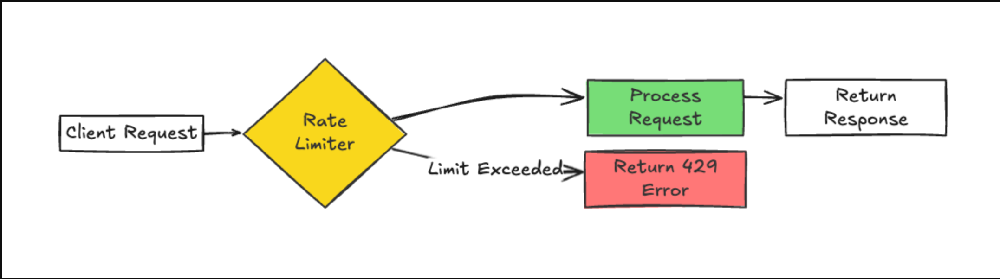
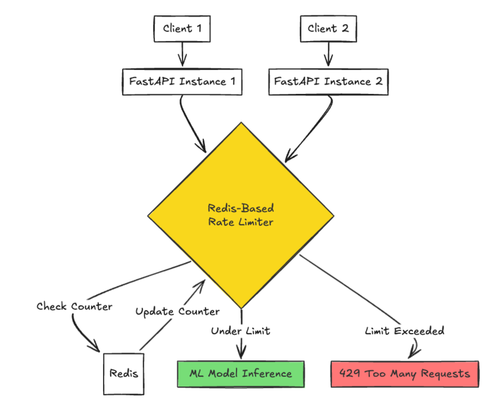
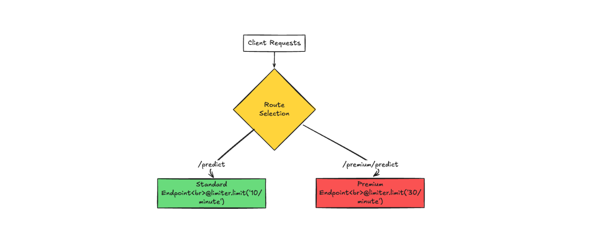

# ADR-001: Rate Limiting Architecture

- **Status:** Accepted (V1)
- **Date:** 2026-11-01
- **Decision:** In-memory rate limiting for V1, Redis for V2, and optional SlowAPI integration for V3.

## 1. Context

The API requires rate limiting to prevent abuse, control resource consumption, and ensure fair usage across clients.

Rate limiting is particularly important for resource-intensive operations such as ML model inference.

The implementation will evolve incrementally to avoid introducing unnecessary infrastructure during early development.

## 2. Decision

Rate limiting will be implemented in three stages:

| Version | Implementation | Purpose |
|---------|---------------|---------|
| V1 | In-memory | Simple request limiting |
| V2 | Redis | Distributed rate limiting |
| V3 | SlowAPI (optional) | Simplified rate-limit management |

The rate-limiting logic should remain modular to support future changes without significantly modifying endpoint implementations.

---

## 3. V1 — In-Memory Rate Limiting

### Architecture

V1 - In-Memory Rate Limiting

### Request Flow

1. A client sends an HTTP request.
2. The request passes through the rate limiter.
3. The limiter identifies the client and checks its request count.
4. If the client is under the configured limit, the request proceeds.
5. If the limit is exceeded, the API returns HTTP `429 Too Many Requests`.

### Implementation

V1 uses an in-memory dictionary to store request counters and their associated time windows.

A fixed-window algorithm will be used initially.

**Example policy:**

- Limit: 10 requests
- Window: 60 seconds
- Identifier: User ID or client IP
- Exceeded limit: HTTP 429

Example response:

```json
{
  "detail": "Rate limit exceeded. Try again later."
}
```

A `Retry-After` response header should indicate when the client can retry.

### Advantages

- Simple implementation
- No external dependencies
- Fast in-memory lookups
- Minimal infrastructure requirements

### Limitations

- Counters reset when the application restarts.
- Counters are not shared across application instances.
- Multiple workers maintain independent limits.
- Memory usage requires cleanup of expired counters.
- Concurrent requests require synchronization to prevent counter race conditions.

**V1 Constraint:** The implementation assumes a single FastAPI worker/process. Scaling to multiple workers requires a shared counter store.

---

## 4. V2 — Redis-Based Rate Limiting

### Motivation

As the application scales, multiple FastAPI instances may handle requests simultaneously.

In-memory counters cannot reliably enforce consistent limits across these instances.

Redis will serve as a centralized counter store shared by all application instances.

### Architecture

V2 - Redis-Based Rate Limiting

### Request Flow

1. A client sends a request to a FastAPI instance.
2. The rate limiter identifies the client.
3. The limiter checks and updates the corresponding counter in Redis.
4. If the request is within the limit, processing continues.
5. Otherwise, HTTP 429 is returned.

All FastAPI instances share the same Redis counter state.

### Implementation

Redis keys will identify the client, endpoint, and time window.

Example:

```text
rate_limit:{client_id}:{endpoint}:{window}
```

Counters will use TTL expiration to automatically remove outdated records.

Counter updates must be atomic to prevent simultaneous requests from bypassing the configured limit.

Redis Lua scripts or equivalent atomic operations can be used for this purpose.

### Advantages

- Shared counters across multiple instances
- Supports horizontal scaling
- Atomic counter operations
- Automatic expiration using TTL
- Consistent distributed enforcement

### Trade-offs

- Additional infrastructure dependency
- Redis network latency
- Increased deployment complexity
- Requires Redis failure-handling policies

### Failure Handling

If Redis becomes unavailable, the application must define whether to:

- **Fail open:** Allow requests to preserve availability.
- **Fail closed:** Reject requests to protect resources.

The selected policy should depend on endpoint sensitivity and computational cost.

---

## 5. V3 — SlowAPI Evaluation (Optional)

### Motivation

As rate-limit policies grow, manually maintaining custom implementations may become more complex.

SlowAPI may be evaluated to simplify endpoint-level rate-limit configuration.

### Architecture

V3 - Endpoint-Specific Rate Limiting

### Proposed Implementation

Different endpoints may have different rate-limit policies.

**Standard endpoint:**

```python
@limiter.limit("10/minute")
async def predict(request: Request):
    ...
```

**Premium endpoint:**

```python
@limiter.limit("30/minute")
async def premium_predict(request: Request):
    ...
```

### Considerations

- SlowAPI simplifies rate-limit configuration.
- SlowAPI does not replace Redis.
- Redis can remain the shared storage backend.
- Library compatibility and maintenance must be evaluated.
- Existing rate-limit behavior must remain consistent during migration.

**V3 is optional.** SlowAPI should only be adopted if it meaningfully improves maintainability.

---

## 6. Rate-Limiting Algorithm

The initial implementation will use a **fixed-window counter**.

### Example

```text
Client: user_123
Limit: 10 requests
Window: 60 seconds

Requests 1-10 → Allowed
Request 11    → HTTP 429

Next window   → Counter resets
```

### Future Alternatives

If traffic patterns require more precise enforcement, the following algorithms may be considered:

| Algorithm | Description |
|-----------|-------------|
| Fixed Window | Counts requests within fixed intervals |
| Sliding Window | Reduces bursts around window boundaries |
| Token Bucket | Allows controlled bursts |
| Leaky Bucket | Smooths request processing |

The algorithm should only change when actual traffic requirements justify additional complexity.

---

## 7. Security and Operational Considerations

- Prefer authenticated user IDs or API keys for client identification.
- Use IP addresses for unauthenticated requests where appropriate.
- Trust forwarded IP headers only from configured proxies.
- Apply rate limiting before expensive operations.
- Prevent unbounded in-memory counter growth.
- Ensure concurrency-safe counter updates.
- Return HTTP 429 consistently.
- Include `Retry-After` where appropriate.
- Monitor rejected requests and rate-limit activity.

Rate limiting complements authentication and authorization; it does not replace them.

---

## 8. Migration Strategy

### V1 → V2

Migration to Redis will be considered when the application requires multiple workers or instances, or when shared rate-limit state becomes operationally necessary.

Steps:

1. Define or retain a common rate-limiter interface.
2. Replace in-memory storage with Redis.
3. Implement atomic counter operations.
4. Configure TTL expiration.
5. Preserve existing endpoint policies.
6. Test concurrent requests across multiple instances.
7. Implement Redis failure handling.
8. Monitor performance and rejection rates.

### V2 → V3

SlowAPI will only be considered if maintaining custom rate-limit logic becomes unnecessarily complex.

Steps:

1. Evaluate SlowAPI compatibility with FastAPI.
2. Compare its functionality with the existing implementation.
3. Configure Redis-backed storage.
4. Preserve existing rate-limit policies.
5. Validate HTTP 429 and retry behavior.
6. Adopt only if it provides meaningful benefits.

---

## 9. Consequences

### Positive

- Minimal infrastructure complexity in V1.
- Clear migration path toward horizontal scaling.
- Rate-limit policies remain independent of business logic.
- Redis enables shared enforcement across instances.
- SlowAPI remains an optional abstraction.

### Negative

- V1 cannot enforce globally consistent limits across workers.
- V2 introduces an additional infrastructure dependency.
- Migration requires concurrency and integration testing.
- V3 may introduce unnecessary library complexity.

---

## 10. Final Decision

The application will initially use **in-memory rate limiting in V1** to prioritize simplicity and development speed.

**V2 will migrate to Redis** when distributed enforcement becomes necessary.

**V3 may introduce SlowAPI** if managing custom rate-limiting logic becomes difficult.

Redis and SlowAPI are not mutually exclusive. SlowAPI may be adopted alongside Redis if justified by the application's requirements.

The architecture prioritizes simplicity initially while maintaining a clear path toward scalable, distributed rate limiting.
