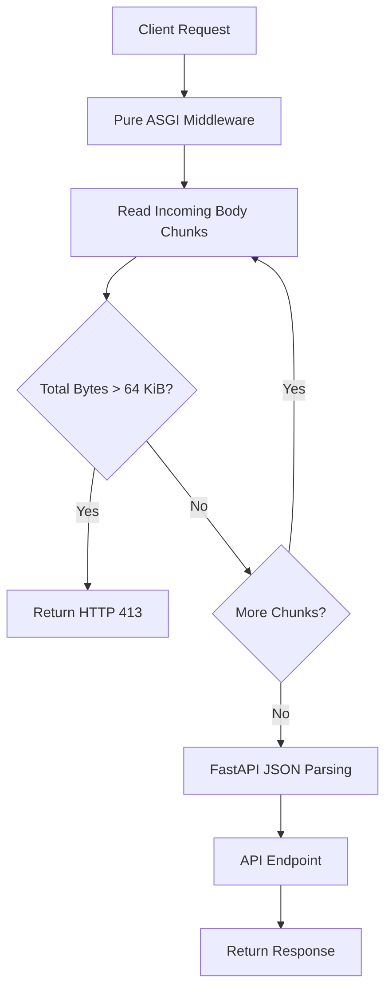

# ADR-002: Request Body Size Limiting

- **Status:** Accepted (V1)
- **Date:** 2026-11-01
- **Decision:** Enforce a 64 KiB request body limit using pure ASGI middleware.

## 1. Current Implementation

The API uses **pure ASGI middleware** to enforce request body size limits before FastAPI parses the complete JSON body.

**Configuration:**

- Maximum request size: **64 KiB (65,536 bytes)**
- Implementation: Pure ASGI middleware
- Enforcement: Actual incoming bytes
- Error response: HTTP `413 Payload Too Large`
- Scope: All HTTP requests with bodies

The middleware intercepts the ASGI `receive` stream and tracks incoming bytes, including requests without a `Content-Length` header.

### Architecture



## 2. Context

Unrestricted request bodies can consume excessive memory and processing resources.

A request size limit protects the API from oversized payloads before they reach endpoint validation and business logic.

## 3. Alternatives Considered

### Option A: Content-Length Validation

Check the `Content-Length` header using `@app.middleware("http")`.

**Advantages:**
- Simple implementation
- Minimal overhead

**Limitations:**
- Clients can omit `Content-Length`.
- The declared size may be inaccurate.
- Does not enforce actual received bytes.

**Decision:** Rejected as the sole enforcement mechanism.

### Option B: Pure ASGI Middleware (Selected)

Intercept incoming ASGI body chunks and enforce the configured limit before the complete body reaches FastAPI.

**Advantages:**
- Counts actual received bytes.
- Works without `Content-Length`.
- Supports chunked request bodies.
- Does not require buffering the entire body.
- Independent of individual API routes.

**Trade-offs:**
- More complex than header-based validation.
- Requires correct handling of ASGI `receive` messages.
- Must preserve request streaming for downstream processing.

**Decision:** Accepted for V1.

### Option C: Reverse Proxy Limits

Enforce request size restrictions using Nginx or an API gateway.

**Advantages:**
- Rejects oversized requests before reaching FastAPI.
- Reduces application resource consumption.

**Limitations:**
- Requires additional infrastructure configuration.

**Decision:** Consider as defense in depth for future deployments.

## 4. Implementation Requirements

1. Register pure ASGI middleware globally.
2. Intercept incoming HTTP request body chunks.
3. Maintain a cumulative byte counter.
4. Reject requests exceeding 65,536 bytes.
5. Return HTTP 413.
6. Preserve valid body chunks for downstream FastAPI processing.
7. Avoid buffering the entire request body unnecessarily.

Example error response:

```json
{
  "detail": "Request body too large"
}
```

## 5. Testing

| Scenario | Expected Result |
|----------|-----------------|
| Body below 64 KiB | Allowed |
| Body exactly 64 KiB | Allowed |
| Body above 64 KiB | HTTP 413 |
| Missing Content-Length | Actual bytes checked |
| Incorrect Content-Length | Actual bytes checked |
| Chunked body exceeds limit | HTTP 413 |
| Valid JSON payload | Processed normally |

## 6. Consequences

**Positive:**
- Accurate enforcement based on actual received bytes.
- Protection before complete JSON body parsing.
- Consistent limits across endpoints.
- No Redis or external dependency required.
- Suitable for the current FastAPI architecture.

**Negative:**
- Requires careful ASGI stream handling.
- Introduces minor per-request overhead.
- Does not replace network-level DoS protection.

## 7. Final Decision

Use **pure ASGI middleware** to enforce a maximum request body size of **64 KiB**.

The middleware counts actual incoming bytes and rejects oversized requests with HTTP 413 before FastAPI processes the complete JSON payload.

Reverse proxy request limits may be introduced later as an additional security layer.
