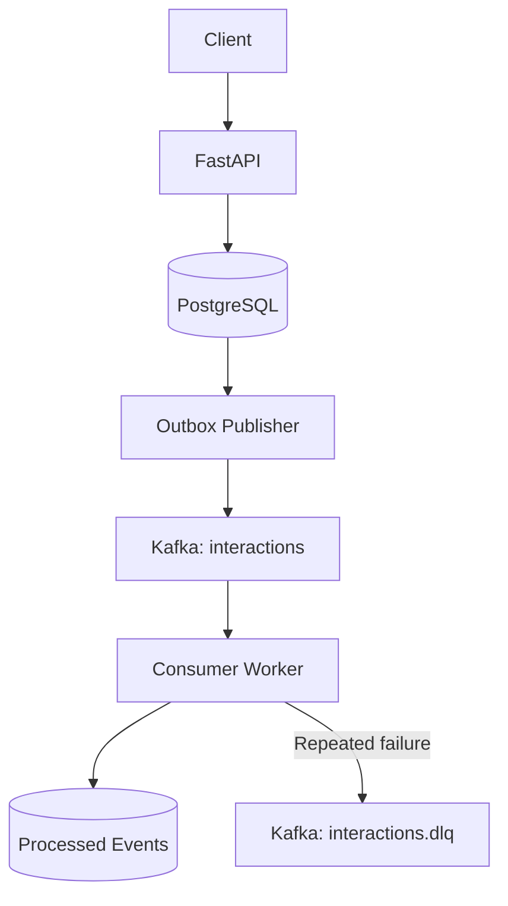

# ADR: Kafka-Based Interaction Event Processing

**Status:** Accepted  
**Project:** Attica  
**Date:** 2026-11-15

## 1. Context

Attica is a multi-tenant application that ingests and stores AI interaction data.

Initially, interactions were stored directly in PostgreSQL through FastAPI. We introduced Kafka to support asynchronous event processing without slowing down API requests.

The system must:

- Reliably publish newly created interactions.
- Prevent duplicate event processing.
- Recover from temporary failures.
- Handle invalid or repeatedly failing messages.
- Maintain tenant isolation.

## 2. Decision

We use **Apache Kafka with the Transactional Outbox Pattern**, a separate publisher worker, and an idempotent consumer.

### Architecture



### Technology Stack

| Component | Technology |
|---|---|
| API | FastAPI |
| Database | PostgreSQL 17 |
| ORM | Async SQLAlchemy 2.0 |
| Migrations | Alembic |
| Message broker | Apache Kafka 4.1.1 |
| Kafka client | aiokafka |
| Event validation | Pydantic v2 |
| Logging | structlog |
| Infrastructure | Docker Compose |

## 3. Implementation

### 3.1 Kafka Infrastructure

Kafka runs locally through Docker Compose using **KRaft mode**, eliminating the need for ZooKeeper.

Configuration:

- Single Kafka broker.
- Persistent Docker volume for Kafka data.
- Pinned Docker image versions.
- Health checks for broker readiness.
- Automatic topic creation through `kafka-init`.
- Kafka UI for monitoring.

Topics:

| Topic | Purpose |
|---|---|
| `interactions` | Stores interaction events |
| `interactions.dlq` | Stores messages that failed processing |

Both topics use one partition and a replication factor of one for local development.

### 3.2 Event Contract

Events are defined using the `InteractionEvent` Pydantic model.

Each event contains:

- `event_id`: Unique event identifier.
- `tenant_id`: Tenant that owns the interaction.
- `interaction_id`: Original interaction identifier.
- `schema_version`: Event contract version.
- `occurred_at`: When the interaction occurred.
- `ingested_at`: When the interaction was stored.
- Interaction data: status, model, tokens, latency, input, output, and scores.

The event ID matches the corresponding outbox record ID.

**Why?**

A consistent contract allows producers and consumers to validate messages and enables event-level deduplication.

### 3.3 Transactional Outbox

When FastAPI receives an interaction:

1. Validate the request and idempotency key.
2. Insert the interaction into PostgreSQL.
3. Create an `outbox_event` record containing the event payload.
4. Commit both records in the same database transaction.

An outbox record is created only for newly inserted interactions.

Duplicate API requests using the same idempotency key and payload return the existing interaction without creating another event.

**Why?**

Publishing directly to Kafka after inserting into PostgreSQL could lose events if Kafka becomes unavailable.

The outbox ensures events remain available for later publication.

### 3.4 Outbox Publisher

A separate asynchronous worker continuously polls PostgreSQL for unpublished outbox records.

Workflow:

1. Select records where `published_at IS NULL`.
2. Lock records using `FOR UPDATE SKIP LOCKED`.
3. Publish messages to Kafka using `send_and_wait()`.
4. Mark records as published after Kafka acknowledges them.
5. Commit the database transaction.

Configuration:

- Batch size: 100 events.
- Polling interval: 5 seconds.
- Kafka producer acknowledgment: `acks="all"`.
- Producer idempotence enabled.
- Failed publishing attempts are logged and retried.

**Trade-off:** Database row locks are held during Kafka publishing. This is acceptable for the initial implementation but may limit throughput.

### 3.5 Consumer Worker

A separate consumer subscribes to the `interactions` topic.

Configuration:

- Consumer group: `attica-interaction-consumers`.
- Automatic offset commits disabled.
- Initial offset reset: `earliest`.

Workflow:

1. Read the Kafka message.
2. Validate it against `InteractionEvent`.
3. Verify the interaction belongs to the specified tenant.
4. Process the event inside a PostgreSQL transaction.
5. Insert a derived summary into `processed_events`.
6. Commit the database transaction.
7. Commit the Kafka offset.

The derived summary includes:

- Event ID.
- Interaction ID.
- Tenant ID.
- Total tokens.
- Latency.
- Error status.
- Whether the output is empty.

Kafka offsets are committed only after processing succeeds or the message has been successfully published to the DLQ.

### 3.6 Idempotent Processing

Kafka provides at-least-once delivery in this architecture.

A worker may crash after Kafka acknowledges publication but before PostgreSQL records the event as published. This can cause the same event to be published again.

To prevent duplicate database effects:

- `processed_events.event_id` is a primary key.
- Inserts use PostgreSQL `ON CONFLICT DO NOTHING`.
- The consumer checks whether the insert succeeded.
- Duplicate events are skipped.
- Database operations execute in one transaction.

**Result:** Duplicate deliveries do not create duplicate processed summaries.

Producer idempotence alone does not prevent application-level duplicate publication.

### 3.7 Retries and Dead Letter Queue

Consumer processing uses bounded retries.

Configuration:

- Maximum attempts: 3.
- Retry strategy: Exponential backoff.
- Retry delays: 1 second, then 2 seconds.

Failure handling:

- Validation errors are sent directly to the DLQ.
- Other processing errors are retried up to the maximum attempts.
- Messages that still fail are published to `interactions.dlq`.
- Kafka offsets are committed only after successful DLQ publication.

Dead-letter records contain:

- Original topic, partition, and offset.
- Number of processing attempts.
- Error type.
- Failure timestamp.
- Original message key and value encoded in Base64.

Base64 preserves the original bytes for future replay.

Sensitive message payloads and detailed error text are excluded from logs.

**Limitation:** Automatic DLQ replay is not yet implemented.

### 3.8 Structured Logging

Workers use `structlog` with contextual information.

Logged fields include:

- `event_id`
- `tenant_id`
- `interaction_id`
- `topic`
- `partition`
- `offset`
- Processing outcome
- Error type
- Retry attempt

Important log events:

| Event | Meaning |
|---|---|
| `interaction_processed` | New event processed or duplicate skipped |
| `interaction_processing_retry` | Processing failed and will retry |
| `interaction_dead_lettered` | Message published to DLQ |

## 4. Delivery Guarantees

The architecture provides **at-least-once delivery with idempotent database processing**.

| Scenario | Behavior |
|---|---|
| Duplicate API request | Existing interaction returned |
| Kafka unavailable | Event remains in outbox |
| Publisher crashes | Unpublished events are retried |
| Duplicate Kafka message | Consumer skips duplicate database insert |
| Consumer crashes before offset commit | Kafka may redeliver the message |
| Invalid event schema | Message sent directly to DLQ |
| Repeated processing failure | Message sent to DLQ after retries |
| DLQ publishing fails | Source offset remains uncommitted |

The system does not guarantee exactly-once message delivery.

## 5. Alternatives Considered

### Direct PostgreSQL → Kafka Publishing

**Rejected:** A database insert could succeed while Kafka publishing fails, leaving the event unpublished.

### Kafka Publishing Inside API Requests

**Rejected:** Couples API latency and availability to Kafka.

### Automatic Consumer Offset Commits

**Rejected:** Offsets could advance before database processing succeeds.

### Unlimited Retries

**Rejected:** A permanently failing message could block processing indefinitely.

### ZooKeeper-Based Kafka

**Rejected:** KRaft removes the additional ZooKeeper dependency and simplifies local infrastructure.

## 6. Consequences

### Benefits

- Reliable asynchronous event publication.
- API requests do not wait for Kafka.
- Independent publisher and consumer workers.
- Protection against duplicate processing.
- Automatic recovery from transient failures.
- Dead-letter handling for problematic messages.
- Structured logging for debugging.

### Trade-offs

- More infrastructure to operate.
- Eventual consistency between ingestion and processed summaries.
- Additional PostgreSQL tables and transactions.
- Duplicate Kafka deliveries remain possible.
- DLQ messages require investigation and eventual replay.
- Single-broker Kafka is not highly available.

## 7. Testing

The following tests have been performed:

### End-to-End Processing

Verified:

```text
FastAPI
  → interaction
  → outbox_event
  → Kafka
  → processed_events
```

The event ID matched between the outbox and processed summary.

### Duplicate Processing

Published the same event multiple times.

Observed:

```text
offset=1 outcome=processed
offset=2 outcome=duplicate
offset=3 outcome=duplicate
```

The consumer correctly identified duplicate deliveries.

### Additional Reliability Tests

- Kafka outage and recovery.
- Consumer restart before offset commit.
- Invalid event routing to the DLQ.
- Repeated transient failure and retry exhaustion.
- DLQ publishing failure.

These should be verified as part of the reliability test suite.

## 8. Future Improvements

1. **DLQ replay:** Safely reprocess failed events after resolving their underlying issues.
2. **Monitoring:** Track outbox backlog, consumer lag, retries, and DLQ volume.
3. **Publisher scalability:** Introduce claim-and-publish leases to avoid long database locks.
4. **Schema evolution:** Establish explicit compatibility rules for future event versions.
5. **Production Kafka:** Use multiple brokers, replication, and appropriate security controls.
6. **Automated testing:** Add integration tests covering failure recovery and delivery guarantees.

## 9. Final Decision

Attica adopts Kafka with the Transactional Outbox Pattern for reliable asynchronous interaction processing.

FastAPI persists interactions and outbox events atomically. A publisher transfers events to Kafka, while an independent consumer validates, deduplicates, and processes them.

Bounded retries and a dead-letter topic prevent repeatedly failing messages from indefinitely blocking the pipeline.

The design prioritizes reliability, recoverability, and simplicity while providing a foundation for future scaling.

# Kafka was chosen because Attica is building an event-processing pipeline, not just a background job queue.
## Technology	Best suited for
Kafka	Event streaming, replay, multiple independent consumers, high throughput
RabbitMQ	Task queues, message routing, background jobs
BullMQ	Redis-backed background jobs, especially in Node.js applications

### Why Kafka for Attica?
1. Event replay: Consumers can reprocess historical interactions.
2. Multiple consumers: Analytics, monitoring, and auditing services can independently consume the same events.
3. Scalability: Partitioning allows parallel processing as interaction volume grows.
4. Event retention: Kafka retains messages based on configured policies, even after consumption.
###  Trade-off
Kafka introduces more operational complexity than RabbitMQ or BullMQ.

Conclusion: RabbitMQ would also work well for Attica's current requirements and might be simpler. Kafka was selected to support future event-driven analytics and multiple independent consumers, rather than because the current workload strictly requires it.